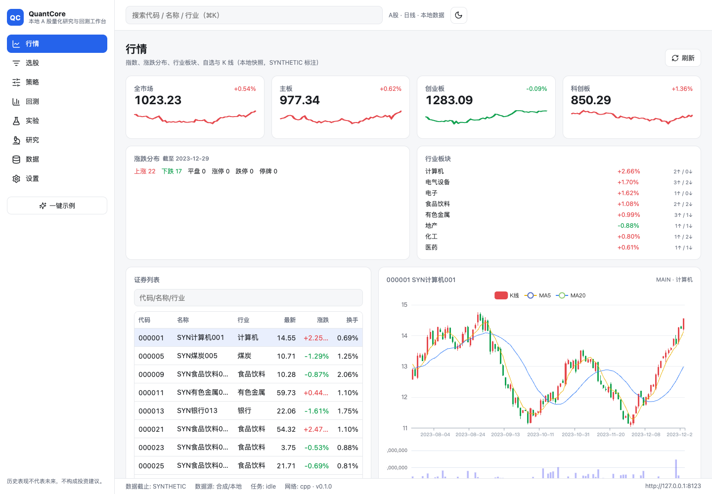
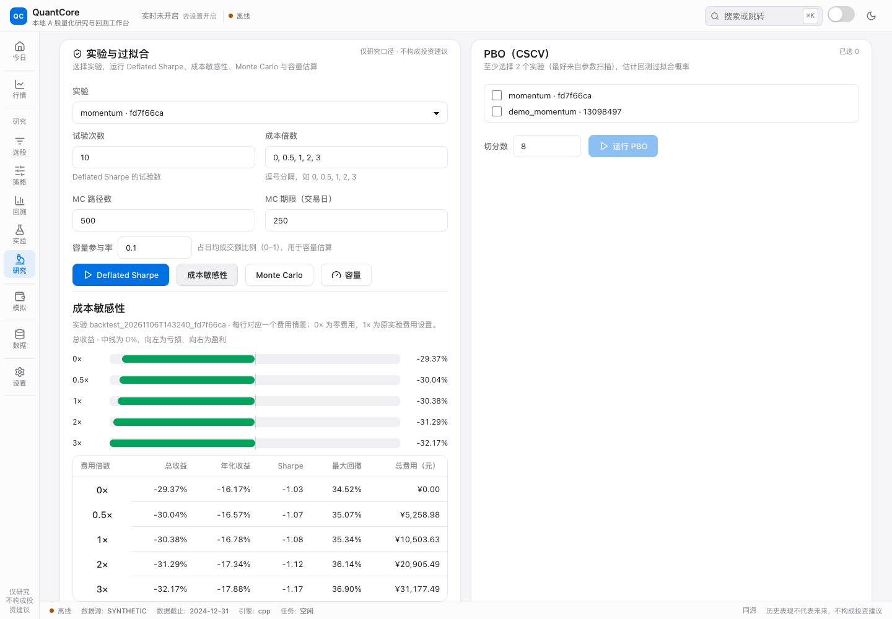

# QuantCore

[简体中文](README.md) · English

**Turn an A-share strategy idea into an experiment you can compare, reproduce and investigate further.**

QuantCore is a local-first quantitative research workbench with a **C++20 backtesting core**.
It connects data checks, strategy backtests, experiment comparison, robustness analysis and paper accounts in one interface. Data and experiment records stay on your machine.

[](https://github.com/feiiiiii5/QuantCore/actions/workflows/ci.yml)
[](cpp/)
[](LICENSE)

[Run locally](#run-locally) · [Architecture](docs/ARCHITECTURE.md) · [API](docs/UI-API.md) · [Validation record](docs/acceptance-report.md)



*The examples use SYNTHETIC data. QuantCore currently supports research and simulation, with no broker connection or real order submission. The interface and most documentation are in Chinese.*

## Follow an idea through the research process

For example, investigate whether stocks with strong recent performance continue to outperform:

1. **Prepare data.** Start with the built-in synthetic demo or import your own data, then inspect coverage, gaps and price anomalies.
2. **Define a strategy.** Choose a momentum or moving-average template and adjust its parameters. Expressions and local strategy plugins support more advanced work.
3. **Run a backtest.** Set dates, initial capital, costs and execution rules; inspect equity, drawdown, metrics and individual trades.
4. **Compare experiments.** Reuse an experiment's saved data and configuration, then compare normalized curves, metric differences and assumptions.
5. **Check sensitivity.** Run cost sensitivity or Monte Carlo on saved experiments, or select multiple experiments for PBO. Factor diagnostics, parameter sweeps and fixed-parameter time splits are configured separately; paper accounts support historical daily replay or virtual fills driven by public live quotes.

## Keep the assumptions beside the results

**See what changed.** Comparison normalizes equity using recorded initial capital and identifies differences in data, dates, capital, costs and rules. Missing conditions are marked unknown.

**Continue with the same data.** Reusing an experiment reads its snapshot or persisted panel, retains configuration and records the new experiment's parent. A parameter change can be distinguished from a data change.

**Keep a record you can inspect.** Experiments save strategy parameters, engine version, data references or panels, results and reports. Replay reruns an experiment and checks equity, trades and metrics; differences across versions still need investigation.

## Capabilities

| Area | What you can do |
|---|---|
| Market and screening | Indices, watchlists, code search, charts and screening; optional public quotes and daily candles without a snapshot, with source timestamps and per-security stale flags |
| Data | Import and snapshot in one job, restored job tracking after refresh, coverage/gap checks, price consistency and data fingerprints |
| Strategies and backtests | Templates, expressions and local plugins; trend momentum, liquid reversal and defensive low-volatility candidates; C++ daily-bar backtests with costs, T+1, lots, cash dividends and splits |
| Experiments | Saved parameters and data, parent lineage, normalized comparison, assumption differences, replay checks and reports |
| Research | Factor IC, groups and decay; parameter sweeps; fixed-parameter time splits; industry attribution; PBO, cost sensitivity and Monte Carlo |
| Paper accounts | Historical replay or live-quote mode, orders and cancellation, T+1, lots, fees, price limits, partial fills, historical pre-tax dividends/per-lot splits, JSON persistence, signal CSV and read-only portfolios |

Cost sensitivity treats fee multipliers as separate scenarios and displays returns, Sharpe, drawdown and fees in yuan:



## Run locally

Source runtime: **macOS or Linux**, Python 3.12, [uv](https://docs.astral.sh/uv/), a C++20 compiler, CMake ≥ 3.26, Ninja, Node.js ≥ 20 and pnpm.
The interface supports light/dark themes, beginner/advanced modes and mobile layouts.

```bash
git clone https://github.com/feiiiiii5/QuantCore.git
cd QuantCore

# Install Python dependencies and compile the C++ extension
uv sync --frozen --python 3.12 --default-index https://pypi.org/simple

# Install and build the interface
pnpm -C ui install --frozen-lockfile
pnpm -C ui build

# Generate synthetic data, a snapshot and a first backtest report
uv run --no-sync qc demo --data-root data

# Open the local workbench using the same data directory
uv run --no-sync qc serve --data-root data --port 8000 --open
```

Dependency installation needs internet access. Once installed, the synthetic demo and local research can run offline. Example data is labelled `SYNTHETIC`.
The server binds to `127.0.0.1`. Open Experiments to inspect the demo result, then reuse its data and parameters for another run.

The data page imports and freezes a snapshot in one local job; navigation does not interrupt it, and a refresh can restore job tracking. Cancellation does not roll back committed data or snapshots. Historical paper accounts apply pre-tax ex-date cash and per-lot splits. Live accounts have no corporate-action feed, and old accounts do not retroactively settle past events. See the [paper model](docs/paper-trading.md) and [API](docs/UI-API.md).

See the [quick start](docs/QUICKSTART.md) and [local testing guide](docs/LOCAL-TESTING.md) for setup, real-data import and troubleshooting.

### Optional live data and private web interface

Start the local server with `QC_ALLOW_NETWORK=1` to look up six-digit codes and view public quotes and unadjusted daily candles without building a research snapshot. Fresh quotes update the current candle; display history does not mutate research data.
Create a live paper account to simulate fills. While that account is selected on the open paper page, the UI requests a refresh every three seconds. Matching uses newly observed volume after the order was submitted. Closing the page stops these requests; there is no unattended matching, order book or real order routing. See the [paper model](docs/paper-trading.md).

The [private Sites frontend](https://quantcore-workbench.blithe-basil-5127.chatgpt.site) connects to your local backend. The C++ engine, Python API, data and accounts remain on your machine. Explicitly allow its browser origin when starting the server:

```bash
QC_ALLOW_NETWORK=1 uv run --no-sync qc serve --data-root data --port 8000 --allow-origin https://quantcore-workbench.blithe-basil-5127.chatgpt.site
```

Enter the local API address and this server's generated token in the web connection settings. The browser may require local-network permission. See [Sites setup](docs/SITES.md) for connection checks and limitations. CORS is disabled by default for the local same-origin setup.

## Native core and application architecture

| Layer | Technology and responsibility |
|---|---|
| Native core | **C++20 `qcore`**: `.qpanel` I/O, native numerical kernels, daily event-driven backtesting, ledger and cost calculations; exposed through pybind11 |
| Application | Python / FastAPI: data ingestion, strategy orchestration and expression evaluation, experiments, research, paper accounts and HTTP/WebSocket APIs |
| Interface | TypeScript / React 19 / Vite: market, strategy, backtest, experiment and research workflows |
| Local storage | Parquet data, DuckDB queries, SQLite state and `.qpanel` engine snapshots |

Production backtests require the native engine and report an error if the extension is missing. The Python reference backtester is test-only; paper matching and some research calculations remain in Python.

### Inspectable validation

Local validation on 2026-11-07: **629 Python tests passed / 2 skipped**, **48 frontend tests**, **21/21 real-server browser tests**, **6/6 C++/reference differential tests**, plus native performance, type and build checks. A separate environment installed the native wheel and passed the synthetic demo, exact replay and four real-browser flows. C++ sources are unchanged in this round; the previous native test run passed **101/101**. See the [delivery guide](docs/RELEASE.md) for the macOS ARM64 local bundle and audit scope; signed installation and full cross-platform validation remain incomplete.

Five identical-input runs over 200 securities × 965 days reduced median panel export time from **290.19ms to 82.80ms (3.50×)** with byte-identical output. Candidate signals were **3.83–5.89×** faster than the original pivot algorithm, with identical weights. The native backtest entry took about **1.73ms**; the warmed, verified-snapshot wrapper took **9.65ms**, excluding signal generation. See the [performance record](docs/PERFORMANCE.md) for samples, caching and end-to-end scope; these are not whole-market measurements.
The [validation report](docs/acceptance-report.md) records scope, reproduced failures and unverified areas. The badge above links to the current CI state.

## Data and current scope

Network data access is disabled by default. Optional public historical and live sources have depth, licensing and adjustment/corporate-action approximation limits. Live quotes support display and local virtual fills, and are not a licensed L2 feed. Simulated fills require valid source timestamps, an open trading session and newly observed volume; they do not guarantee actual execution.
Walk-forward analysis currently uses fixed parameters over time splits. Robustness metrics are research tools. Windows currently has Python smoke coverage and an unsigned client shell; the full C++ backend is not supported there.

Three fixed-parameter candidates have been tested on eight surviving stocks, retaining losses and cost-stress scenarios; see the [strategy study](docs/STRATEGY-STUDY.md). A short sample and approximate corporate actions do not establish persistent excess returns.
The current phase focuses on local research and testing. Sites hosts only the private frontend; production deployment has not been validated. Historical performance does not predict future returns, and results are not investment advice.
See [data licences](docs/DATA-LICENSES.md), [engine semantics](docs/engine-semantics.md) and [rule sources](docs/rules-sources.md).

## Documentation and contributing

- **Get started:** [tutorial](docs/TUTORIAL.md), [quick start](docs/QUICKSTART.md), [local checks](docs/LOCAL-TESTING.md)
- **Understand the system:** [architecture](docs/ARCHITECTURE.md), [strategy guide](docs/strategy-guide.md), [API](docs/UI-API.md)
- **Live data and research:** [paper trading](docs/paper-trading.md), [candidate study](docs/STRATEGY-STUDY.md), [private Sites frontend](docs/SITES.md)
- **Inspect evidence:** [validation](docs/acceptance-report.md), [progress](docs/PROGRESS.md), [performance notes](docs/PERFORMANCE.md)
- **Contribute:** [contributing guide](CONTRIBUTING.md), [issues](https://github.com/feiiiiii5/QuantCore/issues)

Code is licensed under [Apache-2.0](LICENSE). Third-party dependencies and data have their own terms; see [data licences](docs/DATA-LICENSES.md).
