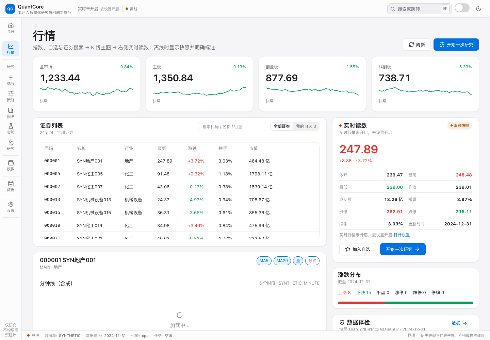
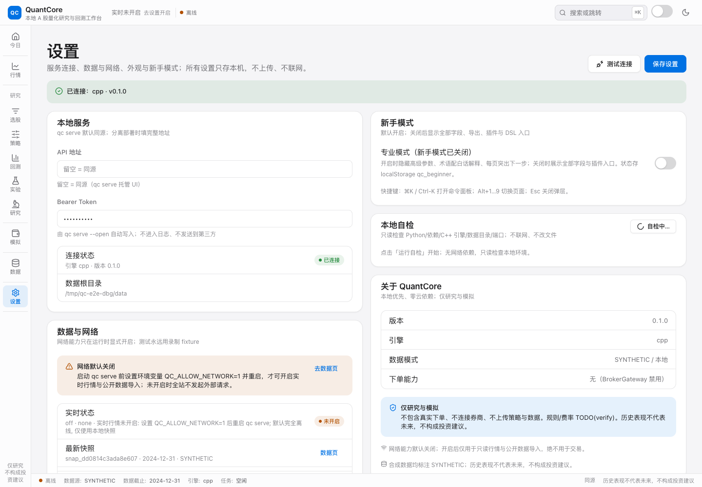
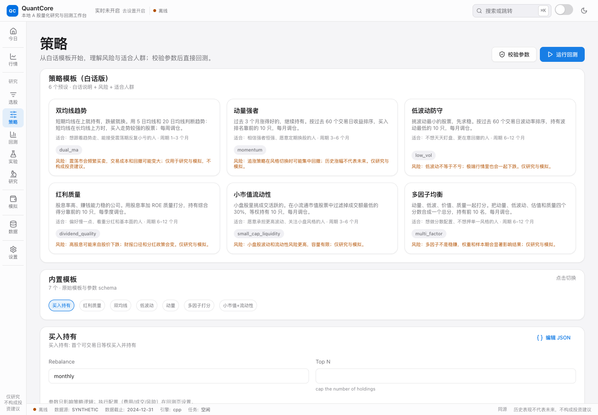

# QuantCore

[](https://github.com/feiiiiii5/QuantCore/actions) · [GitHub](https://github.com/feiiiiii5/QuantCore)

> 本地 A 股量化研究与回测工作台：行情 → 选股 → 策略 → 回测 → 复盘 → 实验复现 → 研究分析。
> 产品理念：**让每个 A 股散户都能做可复现、可解释、可比较的研究**——看得懂、跑得通、信得过。
> **历史表现不代表未来，不构成投资建议；本项目仅用于研究与模拟交易，不含真实下单。**


> 第一次用？先读 [零基础教程](docs/TUTORIAL.md)（10 分钟从安装到看懂第一个回测），或直接 `make demo` 看效果。

QuantCore 是一个 local-first 的量化研究桌面/网页工作台：C++20 引擎负责计算与撮合，
Python 负责数据、策略与实验管理，React 负责交互。数据与策略保存在本机，下载后可离线研究。

界面按 **Apple Human Interface Guidelines**（Clarity / Deference / Depth）设计：系统字体、毛玻璃材质、
34px 大标题、hairline 分隔、8pt 网格与克制动效；工程上优先采用 GitHub 成熟开源方案（Radix UI、framer-motion、
sonner、cmdk、vaul、TradingView lightweight-charts、TanStack、lucide-react），不重复造轮子。

## 设计要点

- **C++ 核心 `qcore`**：定点账本、`.qpanel` mmap 面板、滚动/截面内核与技术指标、回测引擎、绩效指标、差分测试。
- **先正确后快**：每项优化配基准、差分测试、确定性测试；纯 Python 参考实现只放在 `tests/reference`。
- **可验证**：`make verify-cpp` 检查 `engine_backend=="cpp"`、C++/参考实现差分、性能门禁。
- **本地优先**：Parquet 权威数据 + DuckDB 查询 + SQLite 状态 + `.qpanel` 引擎输入；运行期零 CDN（Monaco/lightweight-charts 均本地打包）。
- **同源服务**：`qc serve` 同时提供 FastAPI `/api`、WebSocket 与 `ui/dist`，loopback + Bearer + Host/Origin 校验，无 CORS。
- **仅研究与模拟**：`BrokerGateway` 默认禁用；界面、报告与 API 带免责声明。

## 设计语言与前端技术栈

| 领域 | 方案 | 用途 |
|---|---|---|
| 设计语言 | Apple HIG（见 [DESIGN-SPEC](docs/DESIGN-SPEC.md)）| 毛玻璃 AppBar/StatusBar/Rail、34px 标题、8pt 网格、hairline、120–260ms 动效 |
| 无障碍原语 | `@radix-ui/react-*` | Dialog / Sheet / Menu / Popover / Select / Switch / Tabs / Tooltip |
| 动效 | `framer-motion` | 页面转场、弹层、通知；reduced-motion 关闭 |
| 通知 | `sonner` | 统一 toast（保留旧 `notify()` API） |
| 命令面板 | `cmdk` | ⌘K 模糊搜索 + 键盘导航 |
| 移动端 | `vaul` | iOS 风格 bottom sheet |
| 图表 | `lightweight-charts`（TradingView）| K 线 / 净值 / 回撤 / 柱状；已移除 echarts（初始 JS 1.09 MB → 0.60 MB）|
| 表格 | `@tanstack/react-table` + `react-virtual` | 选股/交易/持仓大表 |
| 数据请求 | `@tanstack/react-query` | 缓存 / 轮询 / 任务进度 WebSocket |

## 快速开始（合成数据，四步）

```bash
# 1) 安装（Python 3.12 + CMake/Ninja + Node/pnpm）
make setup

# 2) 生成合成数据并构建快照（SYNTHETIC，仅用于开发/演示）
uv run qc data update --provider synthetic --n-sec 200 --start 2020-01-02 --end 2024-12-31
uv run qc snapshot build

# 3) 构建 UI（首次或改前端后）
pnpm -C ui build

# 4) 启动本地工作台（自动打开带 token 的 URL）
uv run qc serve --port 8000 --open
```

也可先 `uv run qc backtest run --template dual_ma` 从 CLI 跑通回测；模板列表见 `uv run qc backtest run --help`。
想跳过手动步骤：`make demo`（合成数据→快照→回测→HTML 报告，约 2–3 秒）。

### 真实 A 股数据（可选，联网）

```bash
# 网络默认关闭；设置环境变量后才允许联网。真实数据仅限自用，公开数据不得再分发。
QC_ALLOW_NETWORK=1 uv run qc data update --provider sina \
  --codes 600000,000001,300750 --start 2024-01-01 --end 2026-10-31 --data-root data
uv run qc snapshot build --data-root data --snapshots-root data/snapshots
uv run qc data integrity --snapshots-root data/snapshots   # 覆盖率/缺口/OHLC/涨跌停/复权体检
uv run qc backtest run --template dual_ma --start 2024-06-01 --end 2026-10-31
```

Sina 公开接口免 Token（非官方、无 SLA、约 2000 根日线；成交额为估算、复权与公司行为为近似）；
全市场导入约 30–45 分钟。Tushare 仍需 `TUSHARE_TOKEN`。风险与许可见 `docs/DATA-LICENSES.md`。

### 实时行情（可选，联网）

`QC_ALLOW_NETWORK=1 uv run qc serve --open` 后，行情页会每约 3 秒刷新指数与自选报价（Sina/Eastmoney 公开源，
仅展示、不参与下单；关闭网络时自动显示最近快照并明确标注“离线快照”）。接口：`GET /api/live/{status,indices,quotes}`、`WS /ws/live`。

## UI

| 今日 | 行情 |
|---|---|
|  |  |

| 回测结论 | 回测结果 |
|---|---|
|  |  |

| 数据体检 | 实时行情 |
|---|---|
|  |  |

| 研究 | 模拟 |
|---|---|
|  |  |

| 设置 | 策略 |
|---|---|
|  |  |

| 暗色 | 移动端 |
|---|---|
|  |  |

更多页面截图见 `docs/screenshots/`。UI 支持浅/深色、舒适/紧凑密度、红涨绿跌/绿涨红跌/色盲友好、移动端侧栏折叠；
首页/设置页可切换**新手模式**（默认开启，隐藏进阶字段、显示白话提示）。设计规范见 [docs/DESIGN-SPEC.md](docs/DESIGN-SPEC.md)。

## 开发与门禁

```bash
make build        # 构建 C++ / Python 扩展
make test         # pytest + ctest
make lint         # ruff check/format + mypy
make doctor       # 只读环境自检（Python/引擎/数据/UI/端口）
make demo         # 一条命令跑通 合成数据→快照→回测→HTML 报告
make test-quick   # 快速回归（排除 e2e/bench/network）
make verify-local # doctor + test-quick，分段耗时与 PASS/FAIL
make bench        # C++/Python 基准
make bench-scale  # 规模基准（面板/Parquet/.qpanel/engine/峰值 RSS）
make verify-cpp   # C++ 后端、差分与性能门禁
make ci-local     # 本地完整门禁
make audit        # CycloneDX SBOM + pip-audit 依赖审计
make desktop-smoke # Electron dev shell 启动本地 qc serve + UI（非安装包）
make e2e          # 隔离 qc serve + Playwright（需要本机 Chrome）
```

每天开发推荐入口见 [本地测试总览](docs/LOCAL-TESTING.md)：`make doctor` → `make demo` → `make test-quick`。

本轮实测：pytest **354 collected / 352 passed / 2 skipped**；UI vitest **10 passed**；Playwright **18 passed**；
ctest **95/95**；ruff/mypy（105 files）全绿；`make doctor` ok（engine=cpp）；`make demo` 2–3s 跑通并有指标/HTML 报告；
`make e2e` 会构建 UI，使用临时 data/experiments 启动 `qc serve`，不污染工作区。
真实数据链路已实测：Sina 3 只样本 2049 根日线 → 质量 passed / 0 隔离 → 快照 `source=SINA` → `qc data integrity` **status=ok**、
accuracy 全 0 → C++ 回测成功（`synthetic=false`）。
实时行情已实测：`QC_ALLOW_NETWORK=1` 下 `/api/live/status`=live（source=sina）、`/ws/live` 推送真实个股与 4 指数，
浏览器读数实时刷新且 0 console error；离线时全站不发起行情网络请求。

## 产品与设计

- [产品理念与市场调研](docs/PRODUCT.md)：目标用户、三条支柱（看得懂/跑得通/信得过）、三个创新点、非目标。
- [设计规范](docs/DESIGN-SPEC.md)：信息架构、布局、tokens、组件契约、逐页规格、新手模式、实时行情状态。
- [零基础教程](docs/TUTORIAL.md)：10 分钟从安装到看懂第一个回测（每节都有“你应该看到”）。
- [UI 说明](docs/UI.md) · [快速上手](docs/QUICKSTART.md)

## API 与文档

- [UI/API 契约 v2](docs/UI-API.md) · [快速上手](docs/QUICKSTART.md) · [UI 说明](docs/UI.md) · [零基础教程](docs/TUTORIAL.md)
- [计划与里程碑](docs/PLAN.md) · [进度](docs/PROGRESS.md) · [本地测试](docs/LOCAL-TESTING.md) · [验收报告](docs/acceptance-report.md) · [决策](docs/DECISIONS.md)
- [回测语义](docs/engine-semantics.md) · [规则来源](docs/rules-sources.md) · [数据字典](docs/data-dictionary.md)
- [架构](docs/ARCHITECTURE.md) · [开发环境/镜像](docs/DEV-SETUP.md) · [策略手册](docs/strategy-guide.md) · [R3 审计](docs/AUDIT-R3.md)
- [API](docs/API.md) · [贡献](CONTRIBUTING.md)

## 当前状态（2026-11-02，R4 成熟方案重构轮）

- 设计/UI：Apple HIG 设计系统 v2（tokens + 16 个原语 + 毛玻璃 shell + 10 页重写），Radix/framer-motion/sonner/cmdk/vaul/lightweight-charts 成熟栈；Playwright **18** 条、ui-audit 10 路由 0 console/0 溢出、深色/移动端/色盲通过。
- 实时行情（可选联网）：REST + WS；真实 XSHG 交易日历（exchange-calendars）判断节假日/休市；UI 共享 WebSocket 消费并在失败时回退轮询；已用真实网络验证（live/sina + WS 帧）。
- 真实数据：Sina 公开 provider（5576 只 universe、约 2000 根日线、近似复权）+ 数据体检（API/CLI + 数据页）；真实 3 只样本端到端跑通，integrity=ok。
- 零基础：4 步 onboarding（自动检测）、6 个白话预设、自选 watchlist、`docs/TUTORIAL.md` 教程。
- C++ core：panel/kernels/expression/engine，ctest **95/95**；`make verify-cpp` 差分/基准通过。
- Python：**352 passed / 2 skipped（354 collected）**；ruff/mypy 全绿；数据→快照→C++ 回测→实验/HTML 报告 CLI 端到端。
- 本地工具：`qc doctor`/`GET /api/doctor`、`qc demo`、`make test-quick/verify-local/bench-scale`、`ui/scripts/ui-audit.mjs`；见 [docs/LOCAL-TESTING.md](docs/LOCAL-TESTING.md)。
- 诚实状态：`docs/features.json` **134/134**。仍为文档化限制：无授权 vendor 实时行情（当前公开网页源、仅展示）、无真实下单/券商连接、
  Sina 数据为公开接口（成交额估算、复权近似、全市场导入未端到端验证）、XSHG 日历数据到 2026-12-31、增量复权因子不回溯、全市场 5500×20y 基准未测、签名/公证安装包未做。
  完整缺口与证据见 [验收报告](docs/acceptance-report.md) 与 [AUDIT-R3](docs/AUDIT-R3.md)；不要据本 README 声称可实盘或已 100% 完成。
- 仅研究与模拟；合成数据标 `SYNTHETIC`；真实 Tushare 需 Token，未在本次验证。

## 许可证

Apache-2.0。第三方依赖/数据许可见 `docs/DATA-LICENSES.md`。
