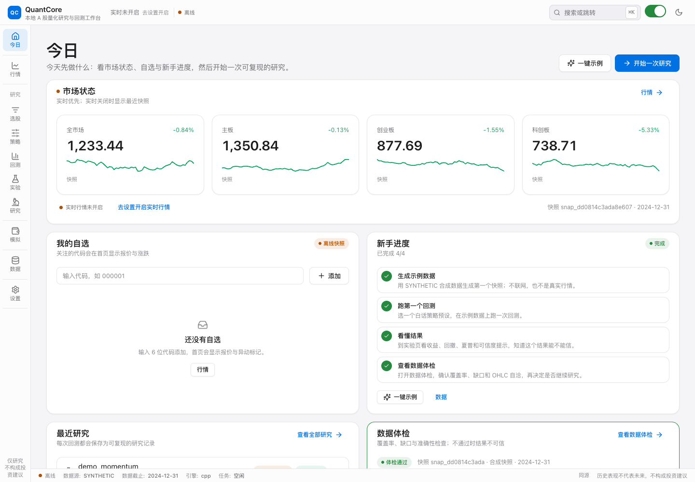
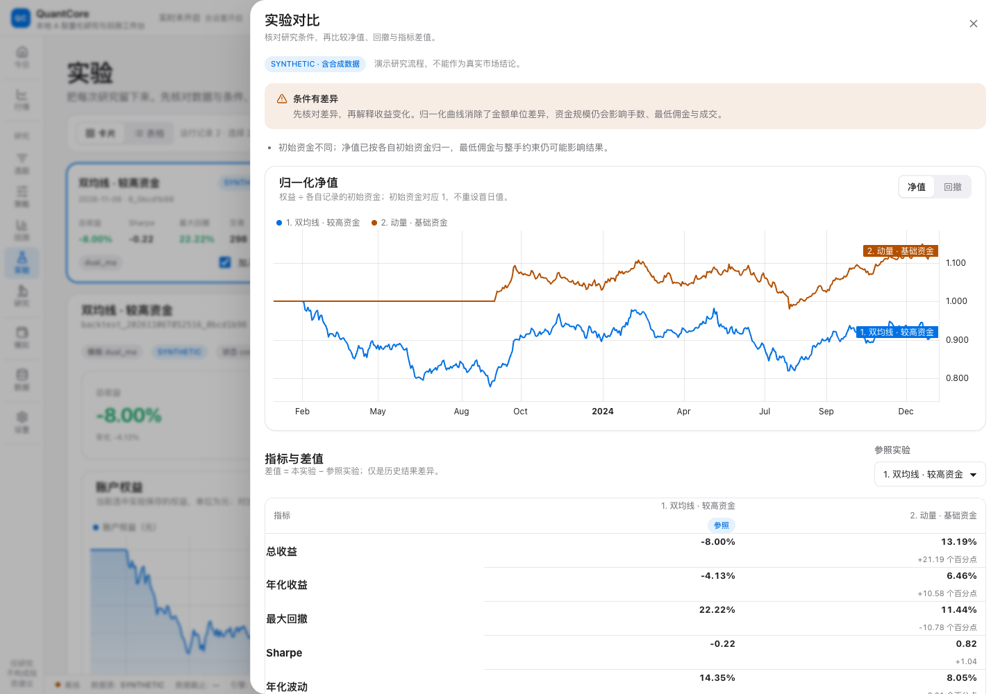
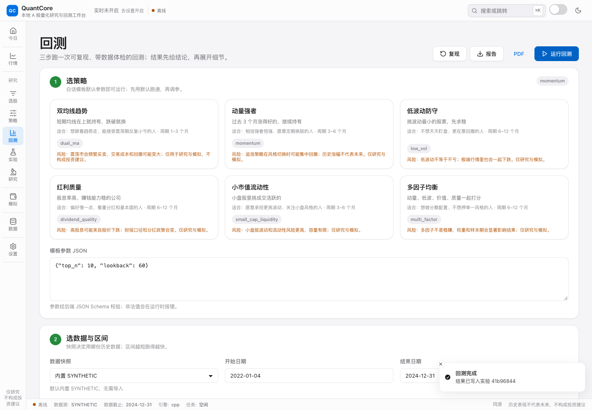
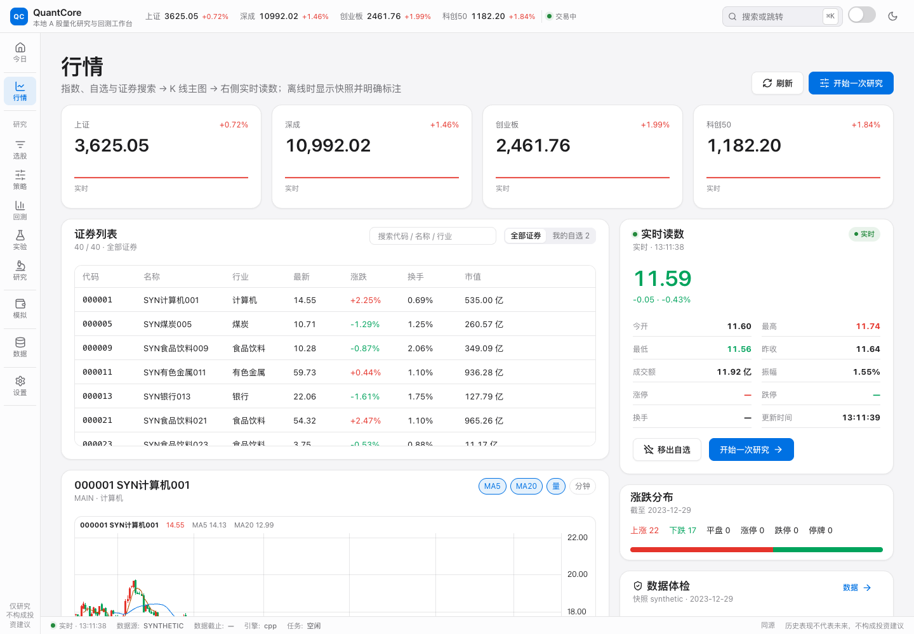
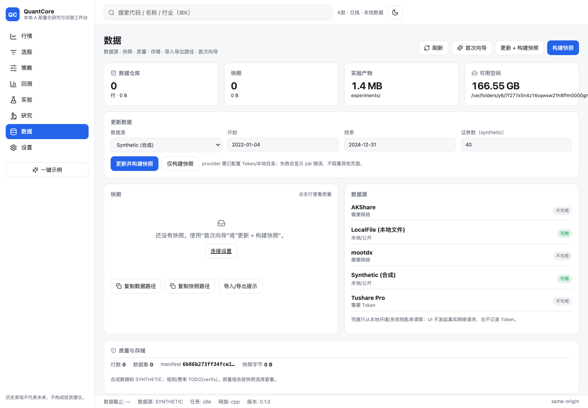

# QuantCore

**给 A 股散户的本地研究工作台。**
把「看到行情 → 想到一个想法 → 验证它 → 读懂结果」接成一条完整的路。

[](https://github.com/feiiiiii5/QuantCore/actions)
· [零基础教程](docs/TUTORIAL.md) · [产品理念](docs/PRODUCT.md) · [设计规范](docs/DESIGN-SPEC.md) · [文档索引](#文档)

> **仅用于研究与模拟**：不连接券商、不下真实单、不承诺收益。历史表现不代表未来，不构成投资建议。



## 为什么做 QuantCore

散户不缺行情软件，也不缺回测库。缺的是一条能走通的路：

> 在行情里看到一个异动，想验证一下，数据不会弄、代码不会写，放弃了。
> 或者回测终于跑出来了，曲线很漂亮，换个时间段就崩，不知道还能不能信。

断掉的是中间四件事：**数据是否干净、结果是否可复现、结论是否可解释、下一步做什么**。
QuantCore 把这四件事做成默认流程，而不是留给用户自己补的功课。

## 它是什么，不是什么

| QuantCore 是 | QuantCore 不是 |
|---|---|
| 本地优先的研究工作台：数据、策略、实验都保存在你自己的电脑上 | 荐股软件，不给买卖建议 |
| 可复现的回测：每个结果都绑定不可变数据快照与实验记录 | 自动交易 / 实盘终端，不连接任何券商 |
| 带数据体检的研究：覆盖率、缺口、OHLC、涨跌停、复权先过检 | 收益承诺，不把研究近似包装成真实市场结论 |
| 零基础也能用的引导：一键示例、白话模板、结论先行的结果页 | 云平台，不上传你的数据与策略 |

## 让一次研究可以继续追问

实验页把数据指纹、策略参数、费用、成交假设与代码版本放在同一个记录里。
选中 2–4 个实验后，对比按各自记录的初始资金归一化的净值、回撤和指标差值，
并逐项标出数据、区间、资金与规则的差异。条件不同可以观察，不能把差值全归因于策略。

点击「沿用数据与参数」会读取原实验保存的快照或面板，保留费用与规则，生成带来源链接的新实验；
不会重新生成一份看起来相似的合成数据。点击「继续研究」会带着当前实验进入稳健性检查。
月收益包含跨月首个交易日的变化；模拟账户成本保留计算精度，不同起始日期的账户组合按共同区间重新配置权重。



## 三条原则

**看得懂。** 打开首页先回答「今天市场怎么样、我的自选怎么样、下一步做什么」，而不是先给一堆表单。
回测结果先给一句人话结论，再展开指标、图表和逐笔交易。

**跑得通。** 内置示例数据和白话策略模板，默认参数就能跑；每页都有下一步。
新手模式默认开启，隐藏进阶字段、术语配白话解释；需要细节时再切专业模式。

**信得过。** 每个结果都带着数据体检与可信度标签：数据覆盖、缺口、成本后口径、样本外与过拟合提示。
数据不完整时页面宁可显示「数据不足」，也不给一个看起来漂亮的假结论。



## 5 分钟跑通第一次研究

前置：Python 3.12、CMake/Ninja、Node 20+ 与 pnpm（macOS / Linux 已验证；Windows 提供 pure-Python smoke）。

```bash
git clone https://github.com/feiiiiii5/QuantCore.git
cd QuantCore
make setup                            # Python 依赖 + 构建 C++ 引擎
make setup-ui                         # 前端依赖（pnpm install）
make demo                             # 合成数据 → 快照 → 示例回测 → HTML 报告（约 2–3 秒）
pnpm -C ui build                      # 构建界面（首次或改前端后）
uv run qc serve --port 8000 --open    # 打开本地工作台
```

第一次打开会看到「今日」页的新手清单：生成示例数据 → 跑第一个回测 → 看懂结果 → 查看数据体检。
全程不联网，数据明确标注为 `SYNTHETIC`，只用于把流程走通。

也可以先用 CLI 跑一次：`uv run qc backtest run --template dual_ma`。

## 界面

| 今日 | 行情（实时） |
|---|---|
|  |  |

| 数据体检 | 研究 |
|---|---|
|  |  |

| 模拟交易 | 暗色 / 移动端 |
|---|---|
|  |  |

界面按 Apple Human Interface Guidelines 设计（Clarity / Deference / Depth）：系统字体、毛玻璃材质、
克制的发丝线卡片、8pt 节奏与有目的的动效；支持浅/深色、舒适/紧凑密度、红涨绿跌/绿涨红跌/色盲友好、
`⌘K` 命令面板与移动端布局。更多截图见 [docs/screenshots/](docs/screenshots/)。

## 你可以在里面做什么

**看市场。** 今日与行情页：4 大指数、涨跌分布、自选、K 线、实时读数与数据来源。
实时行情默认关闭；开启后显示 `实时 · 时间`，关闭或休市时明确标注「离线快照」，不会静默假装实时。

**做研究。** 选股（一句话条件 + 结果表）→ 策略（白话模板 / DSL / 本地插件）→
回测（三步、成本/T+1/手数/涨跌停/停牌规则）→ 实验（对比、复现、报告）→
研究（因子 IC / 分层 / 衰减、参数扫描、滚动验证、行业归因、稳健性）。

**做模拟。** 虚拟账户、逐日回放、T+1、按成交量参与率的部分成交、信号 CSV、提醒与多策略组合；
所有撮合都在本地，明确不是实盘。

**管数据。** 数据体检（覆盖率 / 缺口 / OHLC / 量额 / 涨跌停 / 复权连续性）、真实 A 股导入（可选联网）、
不可变快照；每个结果都绑定快照，可以复现。

**用得舒服。** 新手/专业模式、主题与密度、色盲配色、快捷键（`Alt+1..0` 跳页、`⌘K` 搜索）、
移动端底部导航与抽屉。

## 真实 A 股数据与实时行情（可选，联网）

网络能力**默认关闭**，需要在启动服务前显式开启；未开启时全站不会发起任何行情网络请求。

```bash
# 真实日线（Sina 公开接口，免 Token）
QC_ALLOW_NETWORK=1 uv run qc data update --provider sina \
  --codes 600000,000001,300750 --start 2024-01-01 --end 2026-10-31 --data-root data
uv run qc snapshot build --data-root data --snapshots-root data/snapshots
uv run qc data integrity --snapshots-root data/snapshots   # 先体检，再回测

# 实时行情（服务端显式开启网络后才联网）
QC_ALLOW_NETWORK=1 uv run qc serve --port 8000 --open
```

需要说清楚的限制：Sina 是公开网页接口（非官方、无 SLA、约 2000 根日线），成交额为估算，
复权与公司行为为近似；全市场导入约 30–45 分钟，本轮只端到端验证了 3 只样本。
实时行情来自 Sina / Eastmoney 公开源，约 3 秒刷新、无盘口与 L2，只用于展示，不是授权行情源。

## 技术与质量（给开发者）

- **架构**：C++20 `qcore`（mmap 面板、滚动/截面内核、事件驱动回测引擎，pybind11）+
  Python（数据、策略、实验、FastAPI）+ React 19 / Vite（界面）。
- **界面栈**：Apple HIG + GitHub 成熟方案：Radix UI（无障碍原语）、framer-motion（动效）、
  sonner（通知）、cmdk（命令面板）、vaul（移动抽屉）、TradingView lightweight-charts（图表）、TanStack（表格/数据）。
- **本地优先**：Parquet 权威数据 + DuckDB 查询 + SQLite 状态 + `.qpanel` 引擎输入；运行期零 CDN，
  token 只在本机；网络能力显式开启，测试只走录制 fixture。
- **质量门禁**：pytest 370 passed / 2 skipped、Playwright 18/18、vitest 19、ruff/mypy 全绿；
  既有 CI 覆盖 macOS / Ubuntu / Windows smoke / UI / Windows 打包；当前优化的本机验证见验收报告。
- **可验证**：`make verify-cpp` 检查 C++ 后端、C++/参考实现差分与性能门禁；
  `make e2e` 用隔离服务跑完整 UI 流程，不污染工作区。

## 文档

- 入门：[零基础教程](docs/TUTORIAL.md) · [快速上手](docs/QUICKSTART.md) · [本地测试](docs/LOCAL-TESTING.md)
- 产品：[产品理念与市场调研](docs/PRODUCT.md) · [设计规范](docs/DESIGN-SPEC.md) · [UI 说明](docs/UI.md)
- 工程：[架构](docs/ARCHITECTURE.md) · [回测语义](docs/engine-semantics.md) · [规则来源](docs/rules-sources.md) · [数据字典](docs/data-dictionary.md)
- 接口：[API](docs/API.md) · [UI/API 契约](docs/UI-API.md)
- 过程：[验收报告](docs/acceptance-report.md) · [进度](docs/PROGRESS.md) · [R3 审计](docs/AUDIT-R3.md) · [贡献](CONTRIBUTING.md)

## 已知限制（先说清楚）

- 没有真实下单、没有券商连接；`BrokerGateway` 保持禁用，本项目不是交易通道。
- 实时行情来自公开网页接口，不是授权 feed；约 3 秒轮询、无盘口/L2，仅用于展示。
- 真实历史数据来自公开接口：日线深度约 2000 根、成交额为估算、复权与公司行为是近似；全市场导入尚未端到端验证。
- 目前以源码运行，未提供签名安装包；macOS / Windows 打包产物为 unsigned。
- 所有结论都基于历史数据；历史表现不代表未来，不构成投资建议。

## 许可证与致谢

Apache-2.0。第三方依赖与数据许可见 [docs/DATA-LICENSES.md](docs/DATA-LICENSES.md)。
感谢开源社区：pybind11、FastAPI、DuckDB、pyarrow、Radix UI、framer-motion、sonner、cmdk、vaul、
lightweight-charts、TanStack、lucide 等项目，让一个人也能把一套研究工具做完整。
