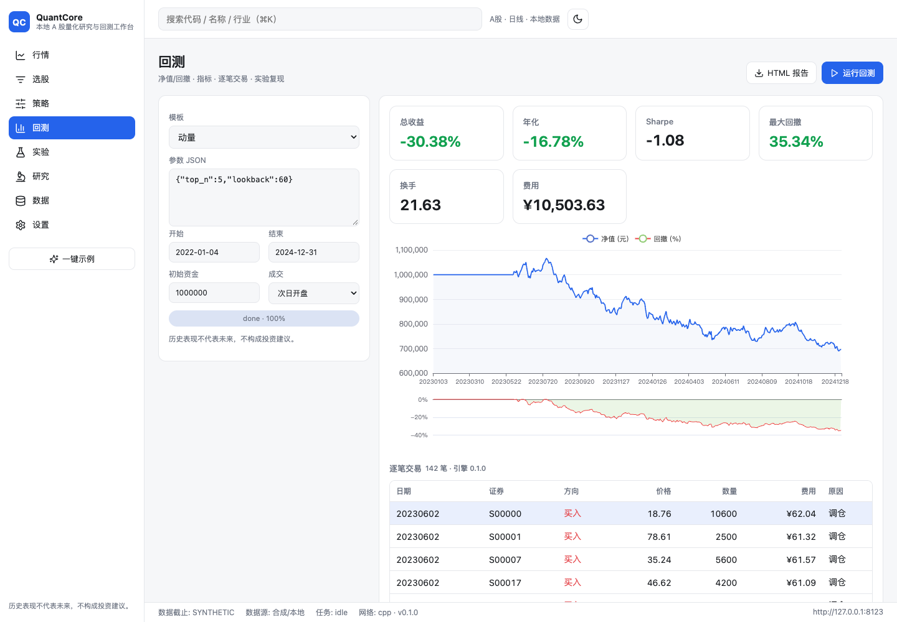
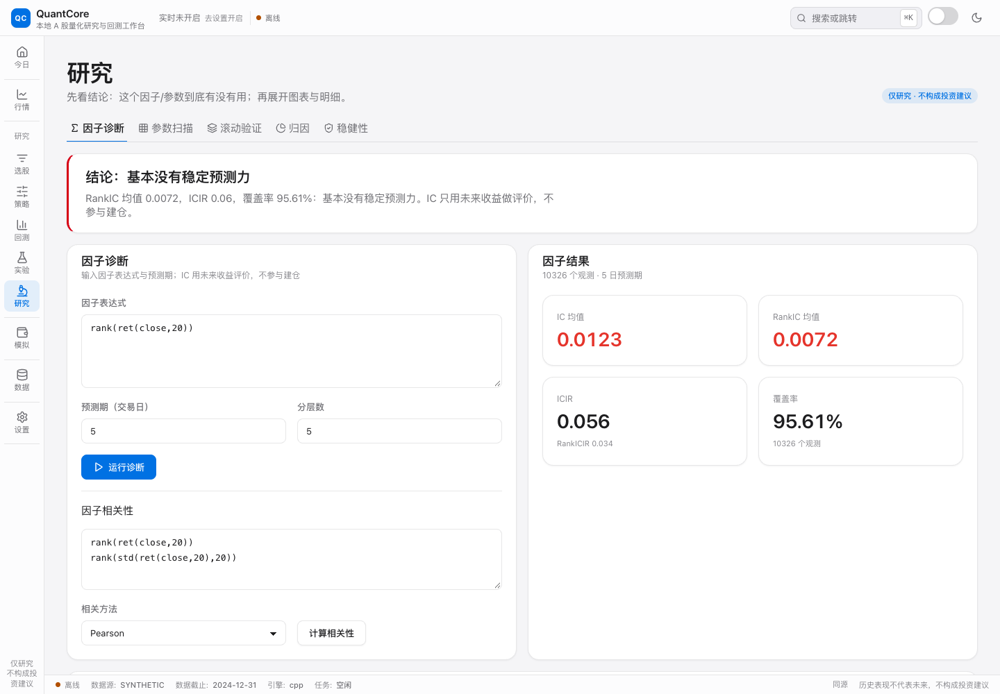
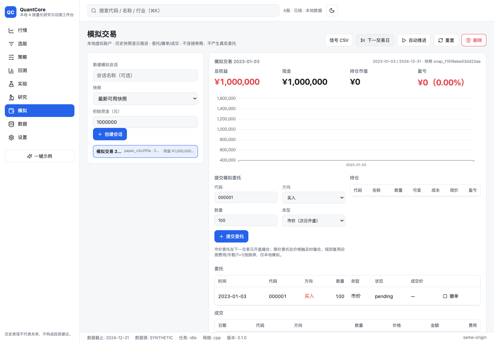
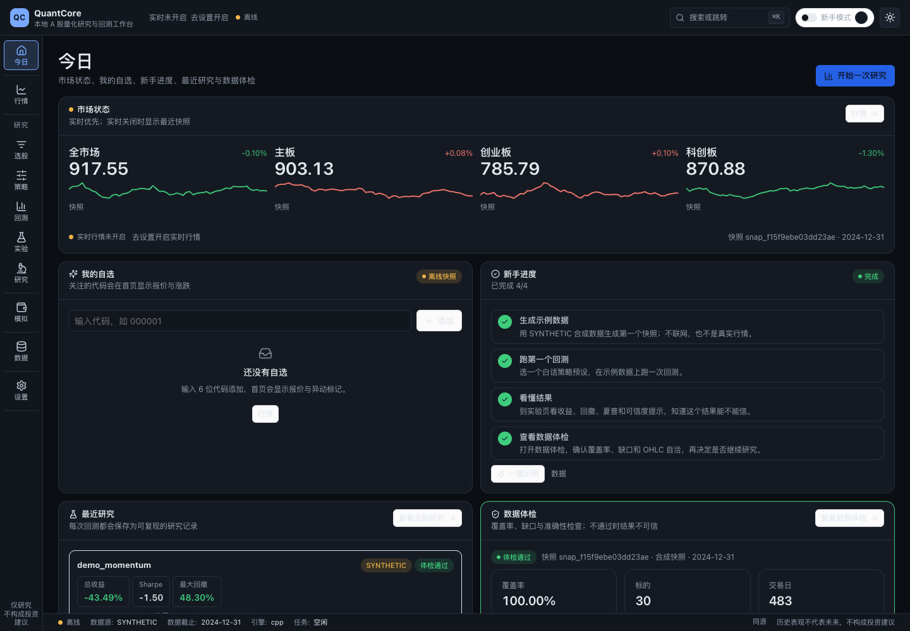
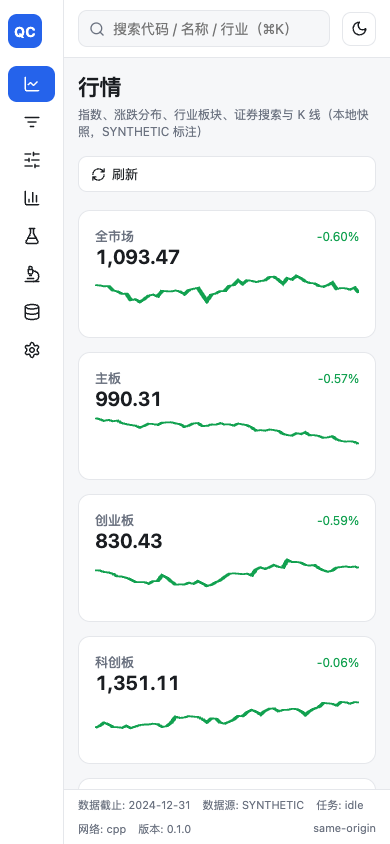

# QuantCore

[](https://github.com/feiiiiii5/QuantCore/actions) · [GitHub](https://github.com/feiiiiii5/QuantCore)

> 本地 A 股量化研究与回测工作台：行情 → 选股 → 策略 → 回测 → 复盘 → 实验复现 → 研究分析。
> **历史表现不代表未来，不构成投资建议；本项目仅用于研究与模拟交易，不含真实下单。**


QuantCore 是一个 local-first 的量化研究桌面/网页工作台：C++20 引擎负责计算与撮合，
Python 负责数据、策略与实验管理，React 负责交互。数据与策略保存在本机，下载后可离线研究。

## 设计要点

- **C++ 核心 `qcore`**：定点账本、`.qpanel` mmap 面板、滚动/截面内核与技术指标、回测引擎、绩效指标、差分测试。
- **先正确后快**：每项优化配基准、差分测试、确定性测试；纯 Python 参考实现只放在 `tests/reference`。
- **可验证**：`make verify-cpp` 检查 `engine_backend=="cpp"`、C++/参考实现差分、性能门禁。
- **本地优先**：Parquet 权威数据 + DuckDB 查询 + SQLite 状态 + `.qpanel` 引擎输入；运行期零 CDN（Monaco/ECharts 均本地打包）。
- **同源服务**：`qc serve` 同时提供 FastAPI `/api`、WebSocket 与 `ui/dist`，loopback + Bearer + Host/Origin 校验，无 CORS。
- **仅研究与模拟**：`BrokerGateway` 默认禁用；界面、报告与 API 带免责声明。

## 快速开始（合成数据，四步）

```bash
# 1) 安装（Python 3.12 + CMake/Ninja + Node/pnpm）
make setup

# 2) 生成合成数据并构建快照（SYNTHETIC，仅用于开发/演示）
uv run qc data update --provider synthetic --n-sec 200 --start 2020-01-02 --end 2024-12-31
uv run qc snapshot build

# 3) 构建 UI（首次或改前端后）
pnpm -C ui build

# 4) 启动本地工作台（自动打开带 token 的 URL）
uv run qc serve --port 8000 --open
```

也可先 `uv run qc backtest run --template dual_ma` 从 CLI 跑通回测；模板列表见 `uv run qc backtest run --help`。

> 真实数据：`qc data update --provider tushare` 需要 `TUSHARE_TOKEN`；无 Token 时全部功能用合成数据 + 录制 fixture 验证。见 `docs/DEV-SETUP.md` 与 `docs/DATA-LICENSES.md`。

## UI

| 行情 | 回测 |
|---|---|
|  |  |

| 研究 | 模拟 |
|---|---|
|  |  |

| 暗色 | 移动端 |
|---|---|
|  |  |

更多页面截图见 `docs/screenshots/`。UI 支持浅/深色、舒适/紧凑密度、红涨绿跌/绿涨红跌/色盲友好、移动端侧栏折叠。

## 开发与门禁

```bash
make build        # 构建 C++ / Python 扩展
make test         # pytest + ctest
make lint         # ruff check/format + mypy
make bench        # C++/Python 基准
make verify-cpp   # C++ 后端、差分与性能门禁
make ci-local     # 本地完整门禁
make e2e          # 隔离 qc serve + Playwright（需要本机 Chrome）
```

本轮实测：pytest **147 collected / 145 passed / 2 skipped**；UI vitest **7 passed**；Playwright **16 passed**；
ctest **95/95**；ruff/mypy 全绿。`make e2e` 会构建 UI，使用临时 data/experiments 启动 `qc serve`，不污染工作区。

## API 与文档

- [UI/API 契约 v2](docs/UI-API.md) · [快速上手](docs/QUICKSTART.md) · [UI 说明](docs/UI.md)
- [计划与里程碑](docs/PLAN.md) · [进度](docs/PROGRESS.md) · [验收报告](docs/acceptance-report.md) · [决策](docs/DECISIONS.md)
- [回测语义](docs/engine-semantics.md) · [规则来源](docs/rules-sources.md) · [数据字典](docs/data-dictionary.md)
- [架构](docs/ARCHITECTURE.md) · [开发环境/镜像](docs/DEV-SETUP.md) · [策略手册](docs/strategy-guide.md)
- [API](docs/API.md) · [贡献](CONTRIBUTING.md)

## 当前状态（2026-11-02）

- C++ core：panel/kernels/expression/engine，ctest **95/95**；`make verify-cpp` 差分/基准通过。
- Python：145 passed / 2 skipped；ruff/mypy 全绿；数据→快照→C++ 回测→实验/HTML 报告 CLI 端到端。
- 服务端：FastAPI 契约、任务队列/取消/崩溃恢复、WebSocket、安全头、GZip；`qc serve` 同源托管构建后的 UI。
- 前端：八页工作台真实接线；行情 K 线/涨跌分布、选股 DSL/导出、策略 Monaco/校验、回测任务/指标/交易解释、
  实验复现/报告/导出/对比、数据中心/onboarding、研究因子/扫描/滚动/归因/稳健性、本地模拟账户/逐日回放；Playwright 16 条。
- 诚实状态：`docs/features.json` **90/117**。M0–M3 核心完成，M5/M6 完成，M7 基础+稳健性（DSR/PBO/成本/MC/容量）与 M9 基础（模拟账户/历史回放/信号 CSV）完成；M8、M9 进阶与部分 M10 仍未实现。
  完整缺口与证据见 [验收报告](docs/acceptance-report.md)；不要据本 README 声称可实盘或已 100% 完成。
- 仅研究与模拟；合成数据标 `SYNTHETIC`；真实 Tushare 需 Token，未在本次验证。

## 许可证

Apache-2.0。第三方依赖/数据许可见 `docs/DATA-LICENSES.md`。
